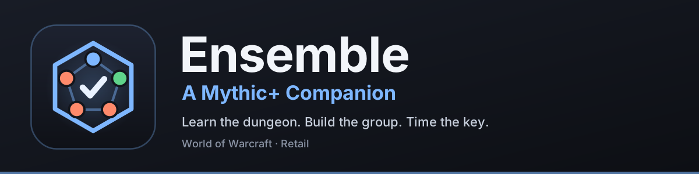

<!-- Generated from branding/overview.md by tools/make_readme.py. Edit that file instead. -->

📖 **[Full guide](docs/Guide.md)** · 📝 **[Changelog](CHANGELOG.md)** · ⚖️ **[License](LICENSE)**

### ⚔️ Command the key. ⚔️

**Learn the dungeon. Build the group. Make the plan. Command the key.**

Keystone Command is a Mythic+ companion addon that helps players of every skill level understand each dungeon, build stronger groups and walk into every key with a plan everyone can follow. It brings group building, dungeon knowledge and planning together in one place, so you spend less time checking guides and more time playing the game.

## ✨ Who it's for

- 🌱 **Newer players** learn how each dungeon works: every trash pack and boss in order, what each mechanic does and how to answer it, with short explanations of why they matter.
- 🪜 **Players pushing higher** learn the details that time keys: the must-kick casts, must-dispel debuffs and must-stop channels, the utility each dungeon asks for, and which classes bring it.
- 🏆 **Experienced players** decide faster, with instant applicant ratings, a clear view of every gap and who covers what, and a written plan to share with the group, all without tabbing out to check a single external guide.

🎮 **Game version:** World of Warcraft Retail, *Midnight* Season 2 (patch 12.1.5).

🔄 **Kept current:** dungeon data is checked against Blizzard's hotfixes. Last checked: patch 12.1.5 and hotfixes through October 13, 2026. The Dungeon tab shows this date too.

---

## 🧰 Features

### 🏰 Dungeons and bosses
- 🗺️ **Every Season 2 dungeon:** Altar of Fangs, Murder Row, Den of Nalorakk, The Blinding Vale, Voidscar Arena, Ruby Life Pools, Kings' Rest and Temple of Sethraliss.
- 📖 **Walkthrough:** every trash section and boss in order, with what each mechanic does and how to answer it, filtered by role if you like. Every boss has a short card with notes for everyone plus tank, healer and DPS lines.
- 🪟 **Boss window:** opens when you enter the dungeon, follows your progress and highlights your own assignments. Resize, lock or fade it in combat, and rewrite any card or post it to chat.
- 🥇 **Best key:** rank every dungeon by how well your current group covers it.
- 📅 **This week's affixes:** read from the game and included in every check and plan.

### 📊 Composition
- 🛠️ **Planner or live party:** plan a comp from scratch or let the slots fill with your real group, then save, load and share comps with an export string.
- 🧭 **Group check:** a summary of what your group has, what's thin and what's missing, with one color-coded chip per key need.
- 🔎 **Every gap explained:** who covers it now, which dungeon casts need it, and which classes could cover it with which ability.
- 💡 **Filling open slots:** the best-fit classes for each empty slot with a short reason, and a preview of what any spec would add or cost before you pick it.
- 🏷️ **Slot badges:** what each player brings, with a marker on anyone who's the group's only source of something.
- 🌟 **Raid buffs:** the buffs your group brings and how well each suits it.
- 🧠 **Talent-aware:** abilities that depend on an optional talent are marked, so you know what's guaranteed.

### 📥 Applicant ratings
- 🚦 **Fit rating:** every applicant rated Great, Good, Fair or Poor with a score out of 100, based on how well their spec fits your group and key. Browsing for a group? Every Mythic+ listing shows how strong a pick you'd be.
- ✅ **Group after:** a plain line saying whether the group is ready once they join (or once you do), or what's still missing.
- 🧗 **Experience:** their best run of this dungeon this season counts too, more so at higher keys.
- 🧾 **Why this score?** A point-by-point breakdown of every rating, and on listings, what you'd add.
- ⚖️ **Compare, sort and filter:** pin two applicants side by side, sort by fit, rating or item level, and hide Poor fits.
- 📨 **Invite from the card**, with a compact panel beside the Group Finder and ratings in Blizzard's own tooltip.
- 📝 **Ready-to-copy lines:** "What we need" for your listing ("LF 2 DPS. Need: Poison dispel, Brez."), and a Sign Up note with your spec, rating, best run and what you'd bring.

### 🗝️ The plan
- 🎯 **Your assignments:** your kicks, dispels and backups in one place.
- ⏱️ **Kick and dispel plan:** rotations shared out by cooldown, with backups for dangerous casts and a "kick first" order. Click any assignment to change who takes it.
- 🥁 **Bloodlust timing:** a sensible default for every dungeon that you can move, annotate or add to.
- 🧭 **Pull by pull:** see each pull's kicks and dispels and who takes them.
- 🔗 **Route support:** the plan and walkthrough follow your Mythic Dungeon Tools route. Not affiliated with MDT, so its updates may briefly break this.
- 💬 **Post to party chat:** the whole plan, one line per player, or just the gaps, in one click.

### 🎓 Learning and history
- 💡 **Learning mode:** plain-language explanations throughout, or switch it off for a compact expert view.
- 📚 **Glossary and tour:** every term one click away, plus a quick tour on first open.
- 📈 **Run history:** your keys saved locally, with timed rates with and without each gap and a takeaway from every run.

### 🎨 Customization
- ↔️ **Resizable window** with adjustable text size and accent colors.
- 🎚️ **Choose what to check:** turn off needs you don't care about.
- 🎛️ **Learning and Expert presets** to set everything up in one click.
- 🌍 **Works on any client language.** Checks use the game's IDs, though the addon's own text is English only.

---

## 🚀 Getting started

1. 📦 **Install it,** then type **`/kc`** or click the minimap button.
2. 🧩 **Planning a group?** Open **Composition** and fill the slots.
3. 📥 **Hosting a key?** List it as usual. The **Applicants** tab opens with every applicant rated.
4. 🔎 **Looking for a group?** Browse the Group Finder. Every Mythic+ listing shows how well you'd fit.
5. 🗝️ **In a group?** Open **Plan** for assignments and Bloodlust timing, then post it to chat.
6. 🏰 **New to a dungeon?** Open the **Dungeon** tab for a walkthrough.

### ⌨️ Slash commands

| Command | What it does |
|---|---|
| `/kc` | Open or close the window |
| `/kc composition` · `applicants` · `dungeons` · `plan` · `history` · `settings` | Open a tab |
| `/kc planner` · `/kc party` | Show the planner or your party |
| `/kc glossary` · `/kc tour` | Open the glossary or the tour |
| `/kc bestkey` | Rank every dungeon for your group |
| `/kc boss [dungeon]` | Open or close the boss window |
| `/kc dungeon <name \| auto \| none>` | Choose the dungeon to check against |
| `/kc text <80-125>` | Set the text size |
| `/kc panel below \| right \| dock` | Move the applicant panel |
| `/kc lock` · `/kc unlock` | Lock or unlock the window |
| `/kc minimap` | Show or hide the minimap button |
| `/kc verify` · `/kc report` | Check the addon against your client, or build a bug report |
| `/kc reset confirm` | Reset all saved data and settings |

---

## 📦 Installation

🔌 **With an addon manager:** search for *Keystone Command* and install it.

🛠️ **Manually:** extract the archive and copy the `KeystoneCommand` folder into `World of Warcraft/_retail_/Interface/AddOns/`, then restart the game.

---

## 🔒 Privacy

Everything runs inside the game. There's no companion app, no web service and no external data. Your comps, settings and run history stay in your own SavedVariables file, and `/kc report` only builds text for you to copy.

---

## ❓ FAQ

🔍 **Does it use Raider.IO or Warcraft Logs data?**
No. It doesn't pull live data from other sites or addons.

📚 **Where does the information come from?**
The same current-patch guides most players already use, like **Wowhead**, **Method.gg**, **Icy Veins** and **Raider.IO**, gathered into one place and checked in game.

🏆 **I'm an experienced player. Is this for me?**
Yes. Turn off learning mode for a compact view and you still get instant applicant ratings, a cooldown-aware plan and history insights.

---

## 🐞 Found a problem?

Type **`/kc report`** in game (or use Settings › Data). Fill in the first few lines, copy the window with Ctrl+A and Ctrl+C, and paste it in a comment here, with a 📸 screenshot if it's visual. For wrong ability or dungeon info, mention where you saw the correct version and I'll check it against the current patch.

---

## 🤖 AI disclaimer

Keystone Command was built with help from Claude, which wrote much of the code and data. Everything is checked against current guides and tested in game, but if something looks off, let me know. The addon itself doesn't use AI.

---

*💙 Keystone Command is a fan-made addon and isn't affiliated with or endorsed by Blizzard Entertainment.*

---

## ⚖️ License

All rights reserved. You may use Keystone Command in game, but its code, data, artwork, name and logo may not be copied, modified or redistributed without permission. See [`LICENSE`](LICENSE).
